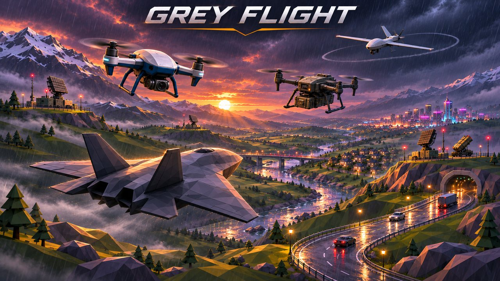
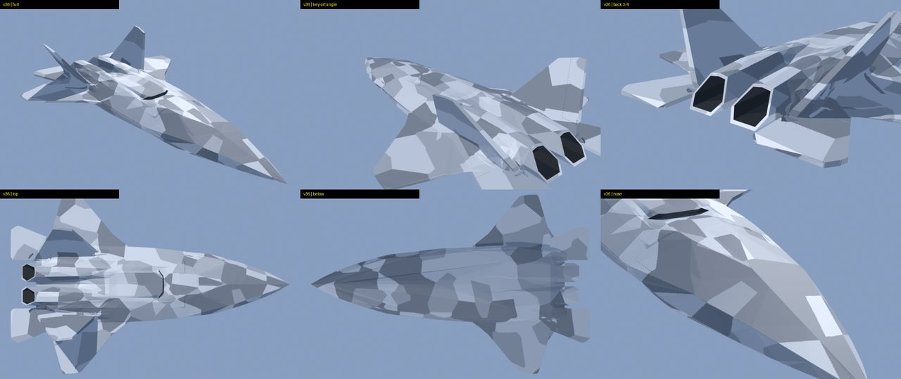
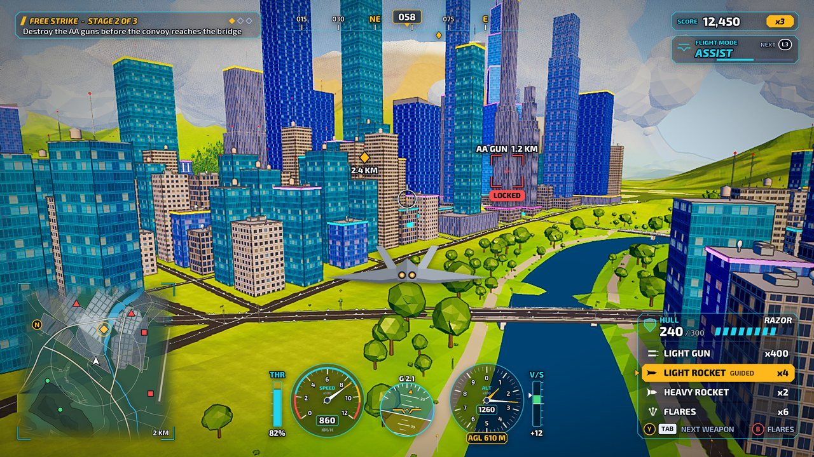
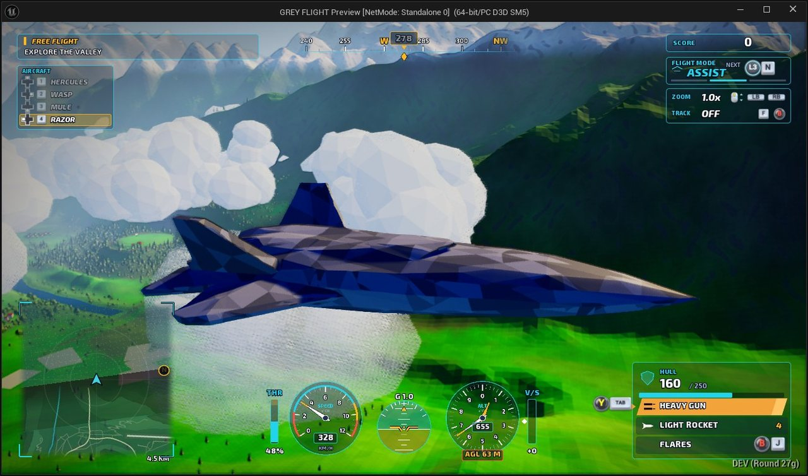
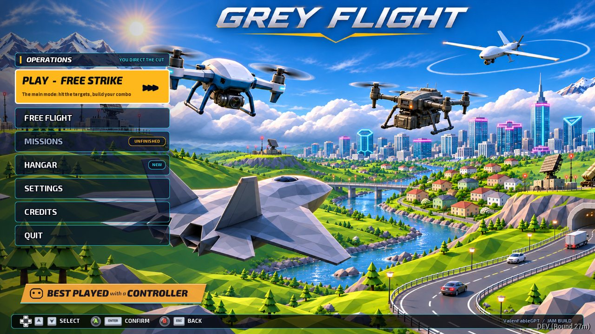
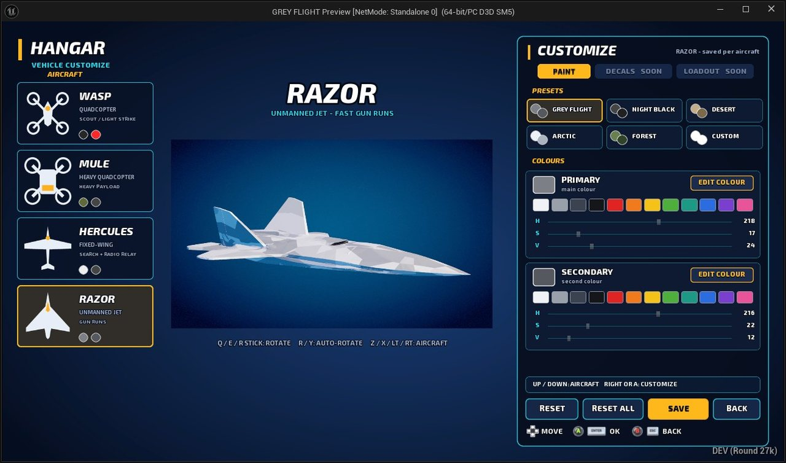
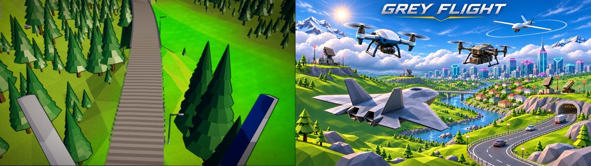
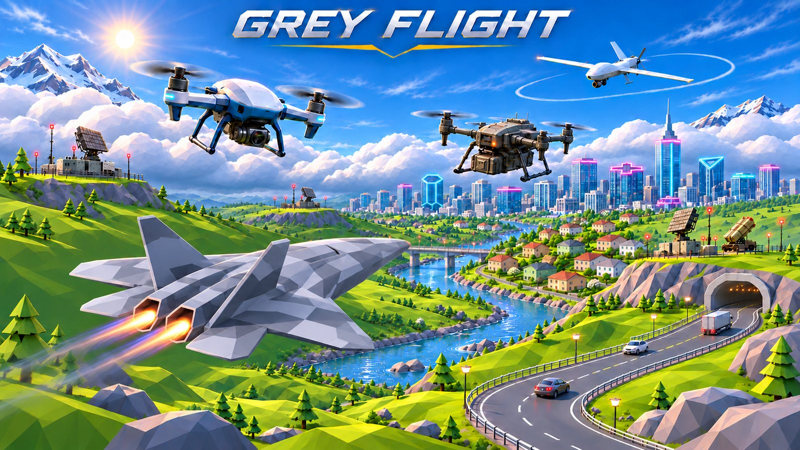
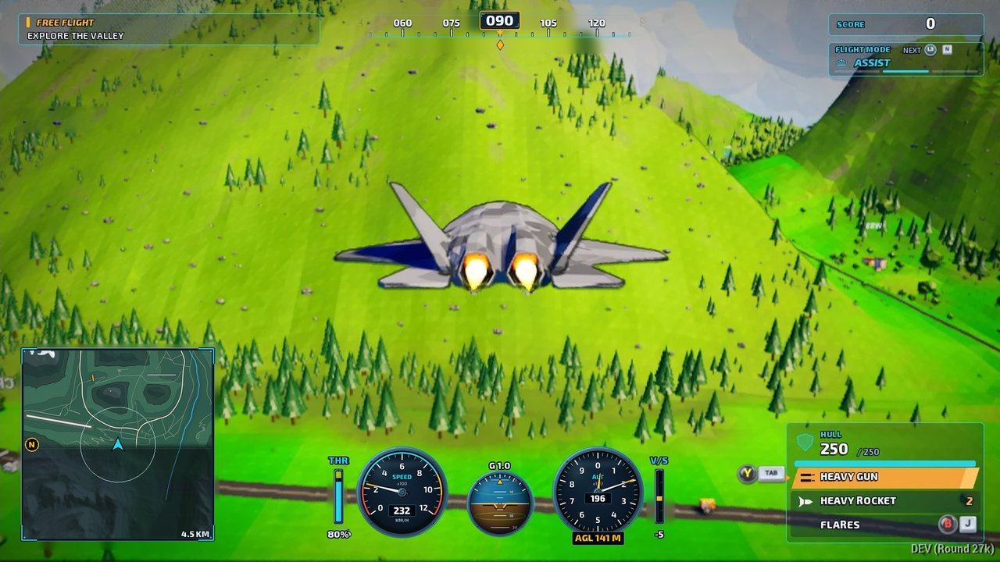
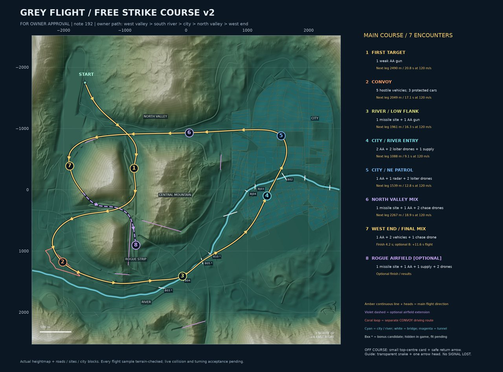

# GREY FLIGHT - how it was made

GREY FLIGHT started as an entry for the **2026 Epic AI MegaJam** (theme: DIRECTOR'S CUT). One human, Valentino (team **ValenFableGPT**), directed a crew of AI agents. The human made every decision. The agents wrote the code, drove the Unreal editor, made the concept art and the models, and reviewed each other's work. Every decision and every build is logged.

Dev logs on itch.io:
- [How one person and a crew of AI agents made GREY FLIGHT in two days](https://valentino718.itch.io/grey-flight/devlog/1782654/how-one-person-and-a-crew-of-ai-agents-made-grey-flight-in-two-days)
- [Installer on GitHub + what we are building next](https://valentino718.itch.io/grey-flight/devlog/1784565/installer-on-github-what-we-are-building-next)

## How the work is done

- **The director (human):** picks the concept, approves or rejects every design, plays every test build, and writes the notes. More than 200 numbered notes so far.
- **AI agents:**
  - Claude Code runs the project and drives the Unreal editor through Unreal's MCP server and editor Python.
  - OpenAI Codex prepares data, designs and images.
  - Fable, Sonnet and Haiku models split the work between design, building and checks.
- **A project dashboard:** a small local web page shows every concept, mechanic and mock-up with Approved / Not approved / Change buttons. The agents only build what is approved.
- **Code-generated world:** the terrain, roads, city blocks, scatter and clouds come from scripts with fixed seeds.
- **Blueprint only:** no C++.
- **Assets:** concept art from ChatGPT image generation and Grok Imagine; 3D models from Meshy and Hyper3D Rodin, reworked in Blender by script; voice and sound effects from ElevenLabs; human-composed music from Dynamedion via WeLoveIndies.

## Timeline

### Fri Nov 13: concept day (the project started one day late)
- 11:20 AM: the project starts. The agents write about 18 concept prompts, and the first image sets are made with Grok Imagine.
- 1:00 PM: the first idea, helicopters, becomes drones. The style becomes a polished low-poly "diorama" valley: a neon downtown, a residential ring and mountains with air defense.
- 2:40 PM: the director locks the concept: GREY FLIGHT, four drones (WASP, MULE, HERCULES, RAZOR), one valley map with one central mountain, and the rule "generate the world with code".
- Evening: the Unreal project, the tool chain (Unreal MCP, Meshy, Blender, importer) and the first core prototype.

### Sat Nov 14: building the game
- The code-generated valley: terrain, rule-based roads, scatter, a modular city.
- Flight models for the four aircraft, feed switching and camera modes.
- The mission director, scoring, air defense, and the first missions.
- Several editor "rounds" ran in a row: one agent in the editor, others preparing assets off-editor.

### Sun Nov 15: polish and submission
- The city, the arch bridge, clouds, crashes, weapons, enemies, a debug spawner and the **FREE STRIKE** mode.
- The trailer was cut from gameplay recordings.
- **8:38 PM: submitted**. Build 5 is the jam version, v1.0-jam.

### Mon Nov 16: post-jam, release 1.2
- **RAZOR rebuilt** part by part: about 30 design iterations from the director's notes, then polygon camo, moving tailerons and rudders, and new exhaust glow.

- **The v29 glass HUD** in every mode, with button icons for Xbox, PlayStation and keyboard.

- **New menus and a HANGAR**: paint every aircraft with a colour wheel.

- **World pass**: roads with markings, guard rails and lamps, civilian traffic, and low-poly cloud banks. Each pass is compared side by side with the concept art.

- A rebuilt **DEBUG LAB** with snapshots, flight-mode cycling, settings with KEEP / REVERT, and a pause menu on START.
- **New key art** with our own RAZOR. It is now the target for every visual pass.

- **Release 1.2** (test build 25) was published here with an installer.

## What is coming next

- **Settings and controls done properly:**
  - every graphics option, including resolution and advanced quality;
  - full key binding for keyboard and pad;
  - button icons that follow the device you use.
- **HUD 29b/29c:**
  - 3D arcade gauges and a faded minimap;
  - a modern bottom-right cluster with a big hull meter;
  - clear weapon and flight-mode change effects;
  - missile lock warnings with a flares prompt.

- **A new FREE STRIKE course** around the whole valley: spread-out stages, a convoy, the city and a hidden bonus. A semi-transparent guide line shows the way.

- **A brighter world:** a stronger sun, a smaller west mountain, more realistic terrain, and closed clouds.
- **Turbo / boost** for the fixed-wing aircraft, with longer exhaust trails and a boost trail.
- **CINEMATIC MODE:** live rewind and slow time while you fly, recording, playback cameras and a talk-over mic. It is for making clips and trailers.
- **The four missions reworked**, then new missions.
- After the jam results: updates on itch.io too, and maybe a Steam release.

The country and the conflict are fictional. Civilians are never targets. No gore.
