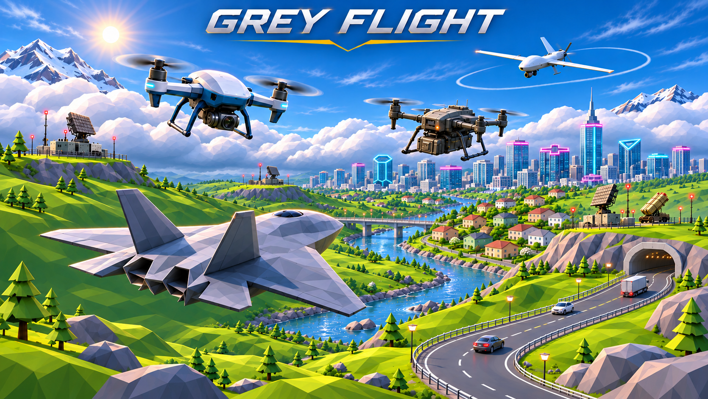

# GREY FLIGHT

**Fly low. Strike fast. Direct the cut.**

A low-poly drone flight and combat game made in Unreal Engine 5.8.4 for the **2026 Epic AI MegaJam** (theme: DIRECTOR'S CUT) by team **ValenFableGPT**: one human director and a crew of AI agents.

## BEST PLAYED WITH A CONTROLLER

Xbox- or PlayStation-style gamepad recommended. Keyboard and mouse also work.

## Download and play (Windows 10/11, 64-bit)

1. Open **Releases** and download `ValenFableGPT_GreyFlight.zip` from **v1.0-jam**.
2. Extract the **whole** zip to a normal folder. Do not run it from inside the zip.
3. Run `ChopperJam.exe`. A short WeLoveIndies intro plays, then the controller screen and title menu.
4. Pick **FREE STRIKE > RAZOR** for the main mode.

Recommended: DirectX 12 GPU with about 6 GB VRAM (developed on an RTX 3060 Laptop), 8-16 GB RAM. No minimum frame rate is promised.

Official page: **[itch.io - GREY FLIGHT](https://valentino718.itch.io/grey-flight)** | Trailer: **[YouTube](https://youtu.be/EtOHJCryipw)**

## The game

One valley: a neon downtown, a thin ring of homes, a mountain bristling with air defense. Four unmanned aircraft: **WASP** (black-and-red quadcopter), **MULE** (heavy quadcopter), **HERCULES** (white fixed-wing, search and radio relay) and **RAZOR** (grey unmanned jet). Every switch between their cameras is an edit.

**FREE STRIKE** is the core mode: fly RAZOR through a gated course along the valley and under the arch bridge, take out enemy guns, missile sites, drones and vehicles, chain clean passes for combo score and skim the terrain for a low-and-fast bonus. Also: FREE FLIGHT, four missions, and a DEBUG LAB (F1) with tuning, teleports and an enemy spawner.

The country and conflict are fictional. Civilians are never targets. No gore, no visible casualties.

## Controls (keyboard / mouse | pad)

| Action | Keyboard / mouse | Pad |
|---|---|---|
| Pitch / roll | W S / A D | Right stick |
| Yaw | Q / E | Left stick X |
| Climb / descend; jet throttle | Space / Ctrl; RAZOR Shift / Ctrl | Left stick Y; RAZOR RT / LT |
| Switch aircraft | 1 / 2 / 3 / 4 | D-pad |
| Camera mode | V | View (tap) |
| Fire / drop | Left mouse | A |
| Next weapon | Tab | Y |
| Countermeasure | J | View + X |
| DEBUG LAB | F1 | Hold View |
| Pause | Esc | Menu |

Full list: README.txt inside the zip.

## Credits and licences

- Direction, design, testing: Valentino (team ValenFableGPT). Unreal Engine 5.8.4, Blueprint only.
- **Music by Dynamedion via WeLoveIndies (weloveindies.com).** Also "Welcome to the Game Jam" by The Late Build x AI.
- Models: Meshy (aircraft), Hyper3D Rodin (vehicles and props). Textures: Poly Haven (CC0) and own procedural textures. Voice/SFX: ElevenLabs and own synthesis. Fonts: Roboto (Apache-2.0), Exo 2 (SIL OFL 1.1).

## AI tools disclosure

Made with heavy AI assistance under one human's direction: Claude Code (Anthropic) and OpenAI Codex / ChatGPT (code, editor automation, reviews), ChatGPT image generation and Grok Imagine (concept art; the key art above is AI-generated concept art, not a screenshot), Meshy and Hyper3D Rodin (3D), ElevenLabs (voice and SFX). Music is human-composed. No game content was made before 12 Nov 2026.

This repository contains release notes only; the game is the zip attached to the release.

## Support the developer

Made by Valentino (The Late Build) directing a team of AI agents. YouTube: https://www.youtube.com/@TheLateBuild - Kick: https://kick.com/thelatebuild - Tips: https://streamlabs.com/thelatebuild/tip
